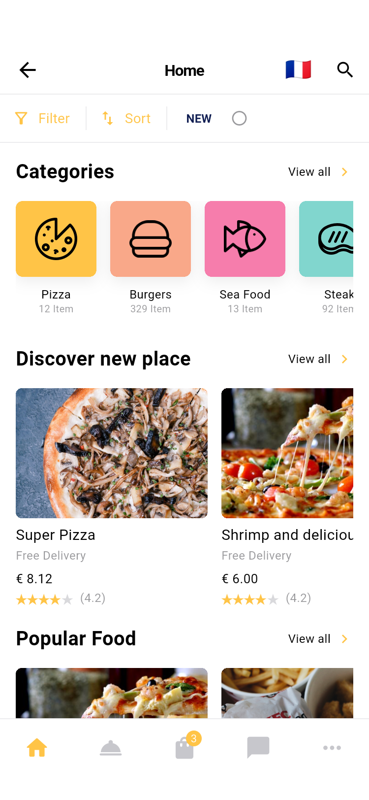
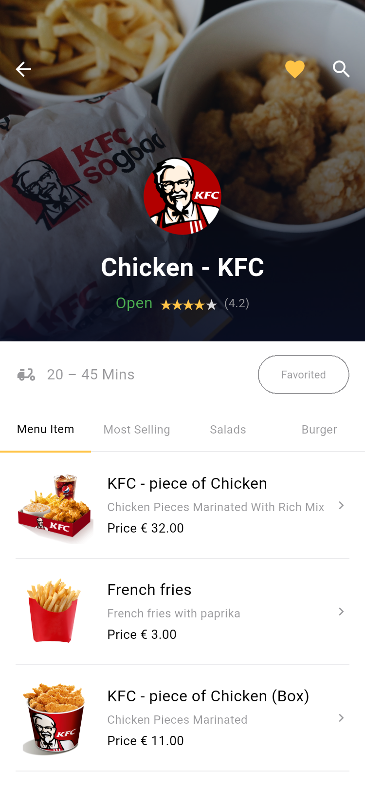
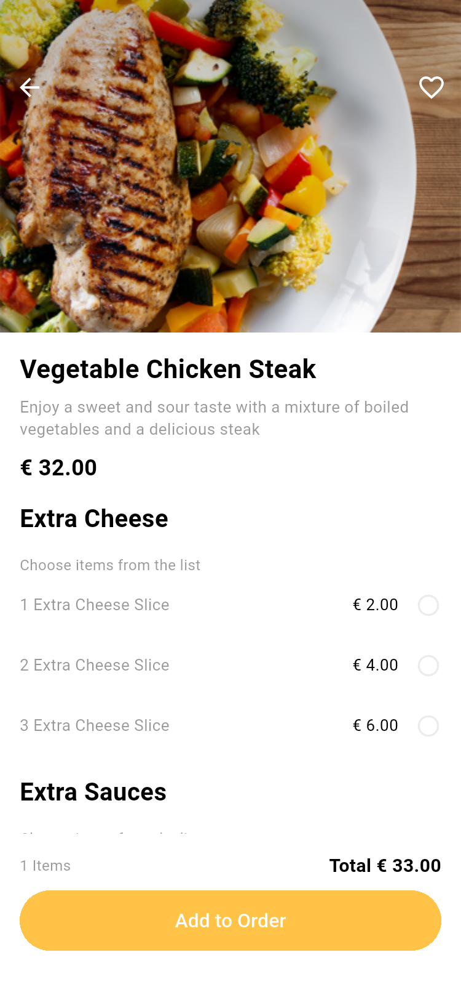
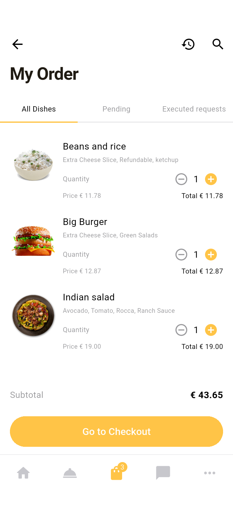
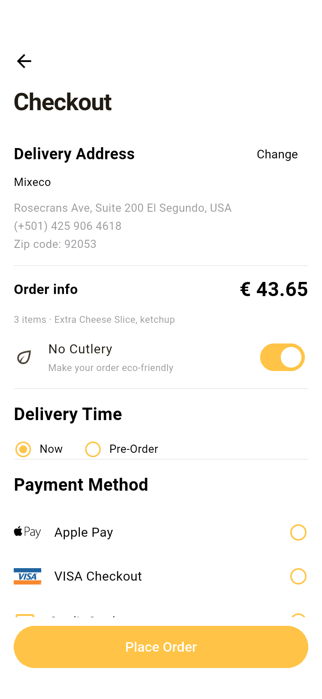
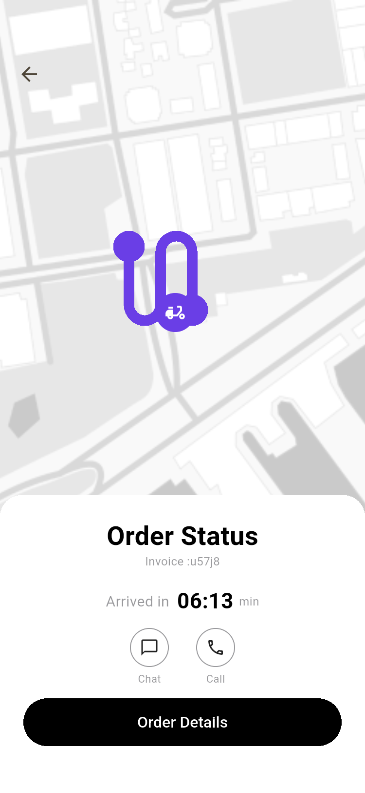

# GUSTO · Flutter 外卖点餐 App

根据 Pixso 中的 **iPhone 11 Pro（60 个界面）** 和 **UI Kit（12 组规范与控件）** 实现的 Flutter 项目。包含餐厅发现、菜品配置、购物车、结算、配送跟踪、聊天、地址、支付表单和账户设置。

默认进入首页。点击底部 **More → 右上角网格图标**，或 **All 60 Pixso screens**，可以逐个打开原稿对应的 60 个界面。页面保留原稿英文文案，本文与架构说明使用中文。

## 主要界面

以下为 Android 模拟器上运行 App 的截图。截图中的购物车、收藏和历史记录使用演示数据；首次正常启动的购物车为空。

| 首页 / 发现 | 餐厅菜单 | 菜品详情 |
| --- | --- | --- |
|  |  |  |

| 我的订单 | 结算 | 配送跟踪 |
| --- | --- | --- |
|  |  |  |

全部界面的编号、Pixso 节点、运行路由、原稿图与 App 截图见 [页面目录](docs/SCREENS.md)。长页面可在 App 内继续滚动，截图记录首屏。

## 运行

验证环境：Flutter **3.41.6** / Dart **3.11.4**，Android 15（API 35）ARM64 模拟器。

```bash
flutter pub get
flutter run -d emulator-5554
```

也可运行 Web 预览：

```bash
flutter run -d chrome
```

项目包含 Android、iOS 和 Web 工程。iOS 需要本机配置可用的模拟器或签名设备；本次未运行 iOS 测试。

直接打开某个设计界面：

```bash
flutter run --dart-define=SCREEN=22
```

`SCREEN` 取值为 1–60，默认 15。正常入口通过按钮跳转；页面目录用于独立审阅各种状态。

## 可体验的流程

1. 首页选择餐厅，进入菜单，点击菜品。
2. 在菜品详情中选择芝士、酱料和数量，点击 **Add to Order**。
3. 在 **My Order** 调整数量；向左滑动可删除。点击 **Go to Checkout**。
4. 选择地址与配送时间。支付可选 **Cash**，或先在支付页添加演示卡。
5. 点击 **Place Order**，进入配送状态；可查看地图预览、订单明细、发送本地聊天消息，并确认收货。
6. 在 More 中管理地址、收藏、促销码、通知开关及个人资料。

登录为本地演示校验：手机号至少 6 位、密码至少 4 位；注册还需姓名。验证码页接受任意 4 位数字。演示卡号为 `4242424242424242`，有效期填写未来月份，CVV 任意 3 位。促销码 **GUSTO15** 减免商品金额的 15%。

## 项目结构与架构

```text
GUSTO/
├── lib/
│   ├── main.dart                 # 初始化 Flutter、本地存储和系统栏
│   ├── app.dart                  # 应用入口、路由分发、60 页浏览目录
│   ├── core/
│   │   ├── store.dart            # 数据模型、演示数据、状态及持久化
│   │   ├── screens.dart          # Pixso 界面编号、名称和节点映射
│   │   ├── theme.dart            # 颜色、字体、输入框与主题
│   │   └── widgets.dart          # 页面骨架、按钮、搜索、数量与底栏
│   └── features/
│       ├── auth.dart             # 引导、登录、注册、重置与验证
│       ├── browse.dart           # 发现、分类、餐厅、菜品、搜索与筛选
│       ├── orders.dart           # 购物车、结算、订单、配送与聊天
│       └── account.dart          # 地址、支付、通知、促销与个人账户
├── assets/
│   ├── images/                   # 从 Pixso 导出的本地图片、Logo、图标
│   └── fonts/                    # Roboto 字体及许可证
├── test/widget_test.dart         # 状态计算、60 页布局、下单流程测试
├── integration_test/app_test.dart # Android 集成测试与逐页截图
├── test_driver/integration_test.dart
├── tool/                        # 截图目录与预览生成工具
├── docs/
│   ├── ARCHITECTURE.md            # 架构、数据流、状态和扩展方法
│   ├── SCREENS.md                 # 60 页映射与截图索引
│   ├── VALIDATION.md              # 测试环境、结果和复现命令
│   ├── design/                   # 60 张 Pixso 原稿图
│   └── screenshots/              # 60 张 Android App 截图和概览
├── android/
├── ios/
└── web/
```

采用 Flutter 原生 `Navigator + ChangeNotifier + InheritedNotifier`。页面按业务领域组织，共用页面骨架、按钮、列表行、数量控件与数据层；相似设计稿通过页面状态参数复用，避免保留 60 份静态生成代码。唯一运行时第三方依赖是 `shared_preferences`。

详细的数据流和扩展方式见 [架构说明](docs/ARCHITECTURE.md)。

## 数据与实现范围

这是可运行的 UI 与本地交互演示。购物车、收藏、地址、银行卡末四位、资料、消息和设置保存在设备本地；不保存完整卡号、CVV 或登录密码。

短信、第三方登录、真实扣款、推送、定位、地图路线、外部通话和服务端聊天尚未接入。地图使用 Pixso 原图，拖动图钉属于位置选择演示；配送时间、餐厅和历史记录使用样例数据。相关入口会显示演示说明，支付不会产生交易。搜索和筛选作用于项目内置的数据集。

沿用原稿的黄色、白底、圆角和主要图片。为适配实际运行，使用原生 Android/iOS 键盘、Roboto 字体、安全区和可滚动布局；部分图标采用 Flutter 原生图标。原稿中的明显拼写错误和不一致的结算金额已修正。

## 验证与构建

```bash
flutter analyze
flutter test
bash tool/capture_screens.sh emulator-5554
flutter build apk --debug
```

集成测试自动保存 `docs/screenshots/01.png` 至 `60.png`。测试记录见 [验证说明](docs/VALIDATION.md)。

已构建 [Android 演示安装包](dist/gusto-demo.apk)，为 Release 模式的本地演示签名包。
