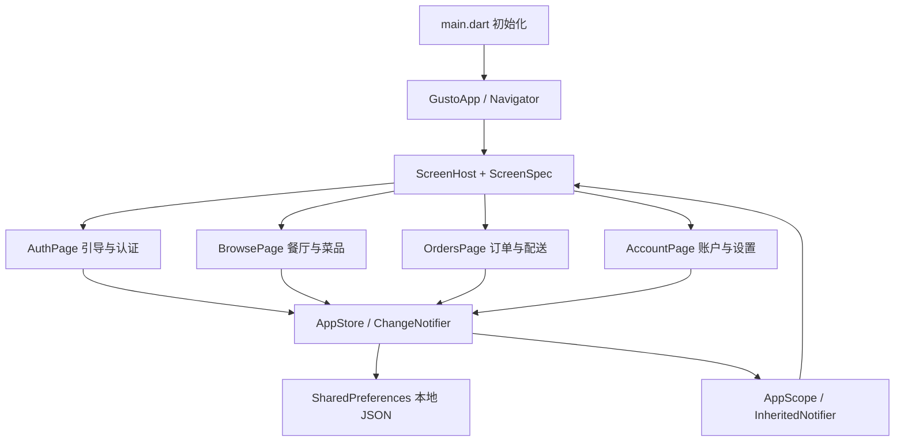

# GUSTO 架构说明

## 分层与责任

此项目采用适合 UI 演示的轻量架构，减少路由与状态管理框架的额外成本。60 个设计界面由四个业务模块与公共组件组合，页面编号只决定初始展示状态。

| 层 | 文件 | 职责 |
| --- | --- | --- |
| 启动 | `lib/main.dart` | 初始化插件、本地存储和系统 UI，再启动 App |
| 路由 | `lib/app.dart` | 解析 `/screen/编号`，分发页面，提供目录与导航容器 |
| 页面元数据 | `lib/core/screens.dart` | 保存 60 个原始界面名称、节点 ID 和分类 |
| 业务与状态 | `lib/core/store.dart` | Food、Restaurant、Address、购物车与配置价格、收藏、订单快照、存储 |
| 视觉规范 | `lib/core/theme.dart` | 黄色、辅助色、Roboto 字体、输入框与开关样式 |
| 公共界面 | `lib/core/widgets.dart` | PageFrame、GustoNav、PrimaryButton、SearchBox、QuantityControl 等 |
| 业务 UI | `lib/features/*.dart` | 局部表单状态、列表展示、事件调用和页面组合 |

## 路由与设计稿映射

每个设计编号对应稳定的 `/screen/N` 路由。`ScreenHost` 将编号分配给业务模块，页面组件使用 `screen` 参数决定布局变体：例如登录页的社交按钮/图标版本、分类网格/列表版本、以及排序/价格/饮食偏好筛选。

More 的网格图标打开 `/screens`。该目录提供全部 60 个设计稿状态，便于验收与截图。底栏五个入口是首页、发现、购物车、配送聊天和更多；切换底栏会清理上一组页面的导航栈。

## 状态与持久化

跨页面数据由一个 `AppStore` 管理，`AppScope` 负责向 Widget 树提供状态。表单内容、当前筛选标签、单页数量等临时状态保留在 `StatefulWidget` 内。

`AppStore.changed()` 通知依赖它的页面刷新，并将持久化字段写入 `gusto.v1` JSON。没有存储实例时，测试可创建纯内存状态，不会影响用户数据。

- 购物车按菜品与配料附加金额区分条目，支持合并相同配置和移除数量为零的条目。
- 单价 = 菜品基础价格 + 所选配料；小计为所有单价与数量的乘积之和。
- 配送费为非空订单 €2；使用 GUSTO15 时，商品小计减免 15%。
- 下单保存订单内容与金额快照，确认收货后清空购物车，历史金额继续保留。
- 支付表单只保存卡号末四位，完整卡号和 CVV 随页面销毁清理。
- 登录密码、验证码和第三方认证均未发送到网络。

## 资源与设计适配

原稿来自 Pixso 的 `iPhone 11 Pro` 和 `UI Kit` 两个页面。主要照片、Logo、分类图标与地图已导出为本地资源，运行时不请求临时 Pixso URL。60 张原稿截图保留于 `docs/design/`，仅用于对照，不作为 App 页面背景。

使用 `Column / Row / ListView / GridView / Sliver` 等 Flutter 布局，避免把界面实现为整页图片或大量绝对坐标。地图图钉与部分视觉遮罩保留 `Stack` 以表达原稿叠加关系。页面最大宽度 560，用于桌面和 Web 预览；手机正常填满屏幕。

## 后续接入接口

后续可在业务层增加 Repository，把当前演示数据和存储操作替换为服务端接口：

1. AuthRepository 处理令牌、验证码与登录失败状态。
2. CatalogRepository 返回餐厅、菜单、筛选结果和分页信息。
3. OrderRepository 以服务端报价、库存和状态为准创建订单。
4. PaymentService 接入支付 SDK，使用令牌化支付数据。
5. MapService 与 ChatRepository 接入真实定位、路线和消息流。

UI 层通过现有状态调用入口更新即可；生产环境应让服务端验证价格、优惠与交易状态。当前本地演示数据不能用于真实交易。

## 精简原则

项目仅保留实际使用的页面模块和素材，不包含 Pixso 导出的临时生成文件、重复绝对布局或 localhost 资源地址。通过复用按钮、页面框架、列表行和状态层统一交互；没有为每张原稿增加独立文件。保留 Flutter 默认 lint，并对所有页面执行渲染检查。
