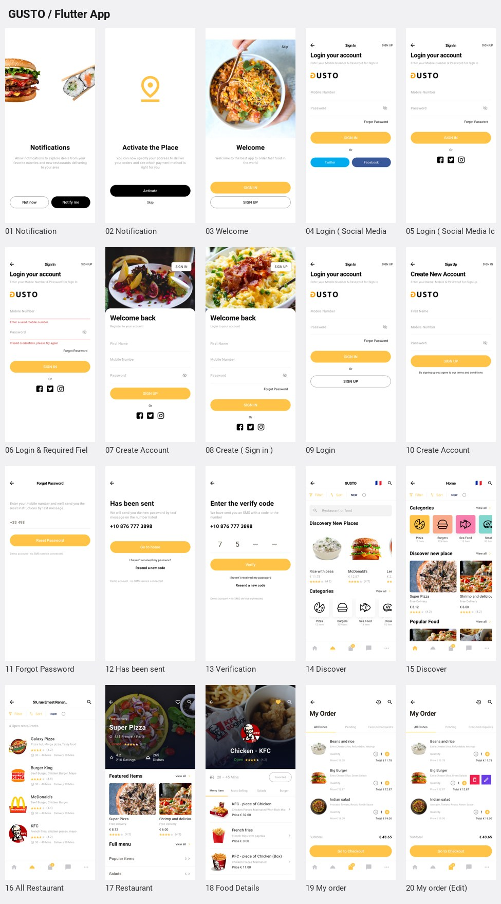
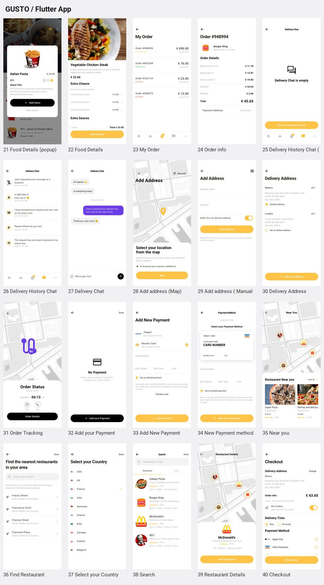
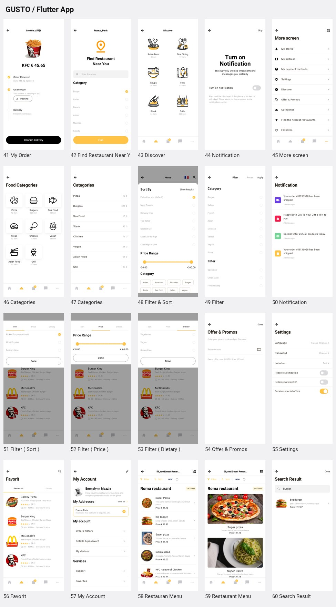

# 60 个界面与 Pixso 映射

来源页面：`iPhone 11 Pro`（`0:1`）。每个编号都有独立可访问的 App 路由和截图；相似界面使用同一业务组件的不同状态。

App 入口：**More → 网格图标 → Pixso Screens**。也可运行 `flutter run --dart-define=SCREEN=编号`。

App 截图由 Android 模拟器集成测试生成；原稿图来自 Pixso 导出。键盘由系统在输入框获得焦点时显示，截图保留未弹出键盘时的 App 首屏。

## 01–20

| 编号 | 原始界面 | 模块 | Pixso 节点 | App 截图 | 原稿 |
| --- | --- | --- | --- | --- | --- |
| 01 | Notification | 认证与引导 | `5:2` | [打开](screenshots/01.png) | [对照](design/01.png) |
| 02 | Notification | 认证与引导 | `5:56` | [打开](screenshots/02.png) | [对照](design/02.png) |
| 03 | Welcome | 认证与引导 | `5:124` | [打开](screenshots/03.png) | [对照](design/03.png) |
| 04 | Login ( Social Media Button ) | 认证与引导 | `5:180` | [打开](screenshots/04.png) | [对照](design/04.png) |
| 05 | Login ( Social Media Icon ) | 认证与引导 | `5:286` | [打开](screenshots/05.png) | [对照](design/05.png) |
| 06 | Login & Required Fields Message | 认证与引导 | `5:775` | [打开](screenshots/06.png) | [对照](design/06.png) |
| 07 | Create Account | 认证与引导 | `5:472` | [打开](screenshots/07.png) | [对照](design/07.png) |
| 08 | Create ( Sign in ) | 认证与引导 | `5:583` | [打开](screenshots/08.png) | [对照](design/08.png) |
| 09 | Login | 认证与引导 | `5:684` | [打开](screenshots/09.png) | [对照](design/09.png) |
| 10 | Create Account | 认证与引导 | `5:384` | [打开](screenshots/10.png) | [对照](design/10.png) |
| 11 | Forgot Password | 认证与引导 | `5:980` | [打开](screenshots/11.png) | [对照](design/11.png) |
| 12 | Has been sent | 认证与引导 | `5:1104` | [打开](screenshots/12.png) | [对照](design/12.png) |
| 13 | Verification | 认证与引导 | `5:1153` | [打开](screenshots/13.png) | [对照](design/13.png) |
| 14 | Discover | 餐厅与菜品 | `5:1277` | [打开](screenshots/14.png) | [对照](design/14.png) |
| 15 | Discover | 餐厅与菜品 | `5:1503` | [打开](screenshots/15.png) | [对照](design/15.png) |
| 16 | All Restaurant | 餐厅与菜品 | `5:1894` | [打开](screenshots/16.png) | [对照](design/16.png) |
| 17 | Restaurant | 餐厅与菜品 | `5:1779` | [打开](screenshots/17.png) | [对照](design/17.png) |
| 18 | Food Details | 餐厅与菜品 | `5:2473` | [打开](screenshots/18.png) | [对照](design/18.png) |
| 19 | My order | 订单与配送 | `5:2081` | [打开](screenshots/19.png) | [对照](design/19.png) |
| 20 | My order (Edit) | 订单与配送 | `5:2268` | [打开](screenshots/20.png) | [对照](design/20.png) |

## 21–40

| 编号 | 原始界面 | 模块 | Pixso 节点 | App 截图 | 原稿 |
| --- | --- | --- | --- | --- | --- |
| 21 | Food Details (popup) | 餐厅与菜品 | `5:3780` | [打开](screenshots/21.png) | [对照](design/21.png) |
| 22 | Food Details | 餐厅与菜品 | `5:3910` | [打开](screenshots/22.png) | [对照](design/22.png) |
| 23 | My Order | 订单与配送 | `5:4066` | [打开](screenshots/23.png) | [对照](design/23.png) |
| 24 | Order info | 订单与配送 | `5:4192` | [打开](screenshots/24.png) | [对照](design/24.png) |
| 25 | Delivery History Chat (Empty) | 订单与配送 | `5:4294` | [打开](screenshots/25.png) | [对照](design/25.png) |
| 26 | Delivery History Chat  | 订单与配送 | `5:4394` | [打开](screenshots/26.png) | [对照](design/26.png) |
| 27 | Delivery Chat | 订单与配送 | `5:4500` | [打开](screenshots/27.png) | [对照](design/27.png) |
| 28 | Add address (Map) | 账户与设置 | `5:4624` | [打开](screenshots/28.png) | [对照](design/28.png) |
| 29 | Add address ( Manually ) | 账户与设置 | `5:4705` | [打开](screenshots/29.png) | [对照](design/29.png) |
| 30 | Delivery Address | 账户与设置 | `5:4906` | [打开](screenshots/30.png) | [对照](design/30.png) |
| 31 | Order Tracking | 订单与配送 | `5:4987` | [打开](screenshots/31.png) | [对照](design/31.png) |
| 32 | Add your Payment | 账户与设置 | `5:5349` | [打开](screenshots/32.png) | [对照](design/32.png) |
| 33 | Add New Payment | 账户与设置 | `5:5098` | [打开](screenshots/33.png) | [对照](design/33.png) |
| 34 | New Payment method | 账户与设置 | `5:5221` | [打开](screenshots/34.png) | [对照](design/34.png) |
| 35 | Near you | 餐厅与菜品 | `5:5395` | [打开](screenshots/35.png) | [对照](design/35.png) |
| 36 | Find Restaurant | 餐厅与菜品 | `5:5515` | [打开](screenshots/36.png) | [对照](design/36.png) |
| 37 | Select your Country | 餐厅与菜品 | `5:5719` | [打开](screenshots/37.png) | [对照](design/37.png) |
| 38 | Search | 餐厅与菜品 | `5:5818` | [打开](screenshots/38.png) | [对照](design/38.png) |
| 39 | Restaurant Details | 餐厅与菜品 | `5:6002` | [打开](screenshots/39.png) | [对照](design/39.png) |
| 40 | Checkout | 订单与配送 | `5:6098` | [打开](screenshots/40.png) | [对照](design/40.png) |

## 41–60

| 编号 | 原始界面 | 模块 | Pixso 节点 | App 截图 | 原稿 |
| --- | --- | --- | --- | --- | --- |
| 41 | My Order | 订单与配送 | `5:7646` | [打开](screenshots/41.png) | [对照](design/41.png) |
| 42 | Find Restaurant Near You | 餐厅与菜品 | `5:7732` | [打开](screenshots/42.png) | [对照](design/42.png) |
| 43 | Discover | 餐厅与菜品 | `5:7911` | [打开](screenshots/43.png) | [对照](design/43.png) |
| 44 | Notification | 认证与引导 | `5:8108` | [打开](screenshots/44.png) | [对照](design/44.png) |
| 45 | More screen | 账户与设置 | `5:8149` | [打开](screenshots/45.png) | [对照](design/45.png) |
| 46 | Categories | 餐厅与菜品 | `5:8327` | [打开](screenshots/46.png) | [对照](design/46.png) |
| 47 | Categories | 餐厅与菜品 | `5:8517` | [打开](screenshots/47.png) | [对照](design/47.png) |
| 48 | Filter & Sort | 餐厅与菜品 | `5:8656` | [打开](screenshots/48.png) | [对照](design/48.png) |
| 49 | Filter | 餐厅与菜品 | `5:8941` | [打开](screenshots/49.png) | [对照](design/49.png) |
| 50 | Notification | 账户与设置 | `5:7547` | [打开](screenshots/50.png) | [对照](design/50.png) |
| 51 | Filter ( Sort ) | 餐厅与菜品 | `5:9300` | [打开](screenshots/51.png) | [对照](design/51.png) |
| 52 | Filter ( Price ) | 餐厅与菜品 | `5:9534` | [打开](screenshots/52.png) | [对照](design/52.png) |
| 53 | Filter ( Dietary ) | 餐厅与菜品 | `5:9767` | [打开](screenshots/53.png) | [对照](design/53.png) |
| 54 | Offer & Promos | 账户与设置 | `5:10010` | [打开](screenshots/54.png) | [对照](design/54.png) |
| 55 | Settings | 账户与设置 | `5:10184` | [打开](screenshots/55.png) | [对照](design/55.png) |
| 56 | Favorit | 餐厅与菜品 | `5:10262` | [打开](screenshots/56.png) | [对照](design/56.png) |
| 57 | My Account | 账户与设置 | `5:10482` | [打开](screenshots/57.png) | [对照](design/57.png) |
| 58 | Restauran Menu | 餐厅与菜品 | `5:9068` | [打开](screenshots/58.png) | [对照](design/58.png) |
| 59 | Restaurant Menu | 餐厅与菜品 | `5:9182` | [打开](screenshots/59.png) | [对照](design/59.png) |
| 60 | Search Result | 餐厅与菜品 | `5:10424` | [打开](screenshots/60.png) | [对照](design/60.png) |

## UI Kit 分类

第二个 Pixso 页面为 `UI Kit`（`27:4`），用于提取组件与视觉规范，不作为独立业务界面。

| 分类 | Pixso 节点 | 使用位置 |
| --- | --- | --- |
| Colors Collections | `27:1386` | 黄色、橙色、紫色、灰色与辅助色 |
| Typography | `27:1175` | 标题、正文、辅助文字 |
| Icon Pack | `27:650` | 分类图标、导航和操作图标 |
| Buttons / Actions | `27:311` / `27:375` | 主要、描边与黑色按钮 |
| Input | `27:458` | 表单输入与错误提示 |
| Controls & Tabs | `27:510` | 选项、开关、页签 |
| Navigation Bars | `27:5` | 页面标题和返回导航 |
| Tab Bars & Toolbars | `27:1228` | 五个底部导航入口 |
| Status Bars | `27:557` | 使用系统状态栏与安全区 |
| ArrowLeft / Back | `27:1511` / `27:1509` | 返回操作 |
